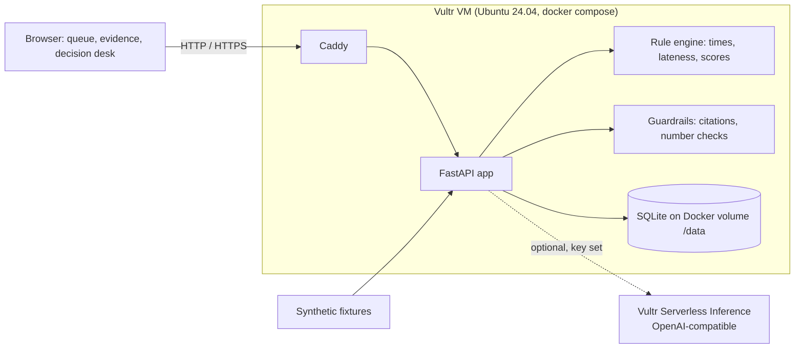

# GradeCase

**A case desk for grading exceptions.** Built for the Vultr: Agent Rush hackathon (lablab.ai x Vultr), Track 2 "Powering the Future of Work".

> **Live demo (HTTP only): http://45.77.185.101** - runs in mock-AI mode on a Vultr VM. See [Deployment status](#deployment-status).
>
> **Synthetic demo data only.** No real student records. No grades are changed and no messages are sent. Canvas is not connected.

## Problem

When a student writes "I submitted on time but it says late" or "I got 0", a TA or professor has to rebuild the story by hand: the same complaint arrives in the LMS inbox, by email and as a submission comment; the facts live in four places (attempt log, deadline, late policy, rubric and gradebook); and a late-policy exception can only be granted by the professor. Replies get duplicated, evidence is lost, and nobody can later say who decided what.

## Solution

GradeCase turns scattered messages into **one case with one evidence bundle**, and keeps a human in every decision.

- **Unified queue and duplicate detection.** Messages from `canvas_inbox`, `email` and `submission_comment` become cases. Cases with the same student, course, assignment and issue are *proposed* as duplicates; a TA confirms any merge. The same student with a different assignment is never proposed.
- **Evidence timeline with stable source IDs** (`ATT-A1`, `RUB-B-row2`, `POL-LATE-v1`). "Not submitted", "unreadable", "empty file" and "alternate evidence" are separate states. A missing professor approval or unreadable file shows an "Insufficient evidence" warning.
- **Score-state reconciliation by rules.** Rubric total, entered score, late deduction, final score and graded-vs-posted are shown separately. Differences are computed, never auto-corrected.
- **Approval routing.** New, TA review, Awaiting professor, Awaiting student info, Closed. A student request alone never approves a waiver. Policy exceptions and score changes route to the professor. A missing policy or conflicting records puts the case on hold.
- **Grounded reply draft.** The draft separates *verified facts* (with evidence IDs) from *unverified* statements. A human edits and approves it, a decision log entry (who, role, action, time, note) is stored, and the screen says "Draft only - not sent".

**Code computes, AI drafts.** Times, lateness and scores come from `app/engine.py`. The optional AI only classifies, summarizes and drafts, and its output is checked by `app/guardrails.py` (citations must exist; numbers and times that conflict with the code are flagged "Needs verification" next to the code value; promises of a regrade are flagged).

## How it uses Vultr

- **Vultr VM**: the whole app (Caddy + FastAPI + SQLite on a Docker volume) runs on one Ubuntu 24.04 instance via `docker compose`. See [deploy/DEPLOY.md](deploy/DEPLOY.md).
- **Vultr Firewall (recommended, NOT yet configured)**: no Vultr Firewall group is set up on the current VM. We recommend allowing only ports 22, 80 and 443; the steps are in [deploy/DEPLOY.md](deploy/DEPLOY.md).
- **Vultr Serverless Inference (optional, currently NOT connected)**: if `VULTR_INFERENCE_API_KEY` is set, the reply draft is generated through the OpenAI-compatible endpoint. The current deployment has no key, so it runs in a deterministic mock mode and the UI says so; the app only describes itself as using Vultr inference when a key is configured. *TODO: record the model id we choose after checking `/api/models`.*

## Architecture



Details and the data model: [docs/ARCHITECTURE.md](docs/ARCHITECTURE.md).

### Trust boundaries

| Component | Trusted to | Not trusted to |
|---|---|---|
| Rule engine (code) | compute times, deductions, score differences, routing | interpret ambiguous policy |
| AI (optional) | classify, summarize, draft wording | produce numbers, decide policy, promise outcomes |
| Guardrails | reject unknown citations, flag number/time conflicts and commitments | replace human review |
| Student/LMS text | be shown as quoted source text | be followed as instructions (kept in separate `source_text` fields, passed to the model as data) |
| Human TA / professor | decide and approve | (demo role switch is **not** access control) |
| GradeCase | record recommendations | write to Canvas or send messages (neither exists) |

## Demo script (2-3 minutes, Case A)

1. **Queue (20s).** Open the app. Point at the banner. Case A (`CASE-A`, canvas inbox) and `CASE-A2` (email) both carry a *Duplicate candidate* badge; `CASE-D` (same student, HW2) does not. Click **Confirm merge** as TA: evidence combines into `CASE-A` and the merge is logged.
2. **Evidence View (45s).** Open `CASE-A`. Attempt 1 at 22:40 is 79 min early; attempt 2 at 00:10 is 11 min late; the 2-point late deduction was applied because the newest attempt is graded. Score table shows rubric total 9, deduction 2, final 7, entered 7, posted 7 with no differences. Warning: "Insufficient evidence: no professor approval on file". Review item: "Confirm whether ATT-A1 counts", routed to the professor.
3. **Decision Desk as TA (45s).** Open the draft: verified facts cite `ATT-A1`, `ATT-A2`, `SCORE-A`; the policy question is listed as unverified; the text does not say what the outcome will be. **Approve** and **Reject** are disabled (professor-only). Click **Escalate to professor** with a note: status becomes Awaiting professor, logged.
4. **Professor (45s).** Flip the role switch to Professor. Select counted attempt `ATT-A1`, add a note, **Approve**. Status Closed; `APR-A-1` appears as approval evidence; **Apply score change** becomes enabled and records "7 -> 9, recommendation only, not applied in Canvas". Show the decision log.
5. **Wrap (15s).** Open `CASE-C`: policy `POL-LATE-v2` is missing and the emailed file cannot be found, so Approve is blocked and the draft promises nothing.

## Run locally (mock AI, no credentials)

Needs Python 3.12+.

```bash
python -m venv .venv && source .venv/bin/activate && pip install -r requirements-dev.txt
export DB_PATH=./gradecase.db
uvicorn app.main:create_app --factory --reload
```

Open http://localhost:8000. Checks: `ruff check . && pytest -q`. "Reset demo data" in the footer restores the fixtures. To try real inference set `VULTR_INFERENCE_API_KEY`, call `GET /api/models`, then set `LLM_MODEL` (see `.env.example`).

## Deploy to Vultr

Full steps in [deploy/DEPLOY.md](deploy/DEPLOY.md): create a firewall group (22/80/443), create an Ubuntu 24.04 instance with [deploy/cloud-init.yaml](deploy/cloud-init.yaml) as user-data, check `http://<SERVER_IP>/health`. Data persists in the `gradecase_data` Docker volume. cloud-init clones branch `claude/ecstatic-newton-ck2lvo`; switch `BRANCH` to `main` after merge.

## Deployment status

Reported by the team after deploying commit `d6ff215` (the QA below was done on that commit, not on the latest one):

- Live at **http://45.77.185.101** on a Vultr VM, via `docker compose` (app + Caddy).
- The Docker app container reports healthy, and Caddy serves the app over plain HTTP.
- A container restart preserved recorded decisions (SQLite on the `gradecase_data` volume).
- **HTTP only for now.** No domain or HTTPS is configured, so do not enter anything sensitive; the data is synthetic anyway.
- **Real inference is NOT connected.** No `VULTR_INFERENCE_API_KEY` is set, so the AI runs in deterministic mock mode (no model is called). The Vultr Serverless Inference client exists in the code but has not been exercised against the live API.
- The VM is paid for with an ordinary signup promotion. We are not claiming hackathon credits.

## Demo URL / video / slides

- Demo URL: http://45.77.185.101 (HTTP only, mock AI)
- Demo video: TODO
- Slides: TODO

## Limitations

- **Synthetic data only.** Do not load real student records. Using GradeCase with real data requires FERPA and institutional review (data handling, retention, access control, vendor review) that has **not** been done.
- **Demo roles are not access control.** The TA / Professor switch is a UI label that the API trusts; there is no login.
- **No Canvas integration.** Messages and course data come from fixtures; nothing is read from or written to Canvas. Canvas would stay the system of record in a real deployment.
- **No sending.** Replies are drafts. No email or LMS message is sent.
- Assignment for a message comes from fixture metadata; real inference of the assignment is future work.
- Late policy rules handled: flat percentage within a window and "newest attempt graded". Other policies are not modelled; unknown policies put the case on hold.
- Single worker and SQLite: fine for a demo, not for production.

## Team

- TODO: Name 1 - role
- TODO: Name 2 - role

## License

MIT - see [LICENSE](LICENSE).
