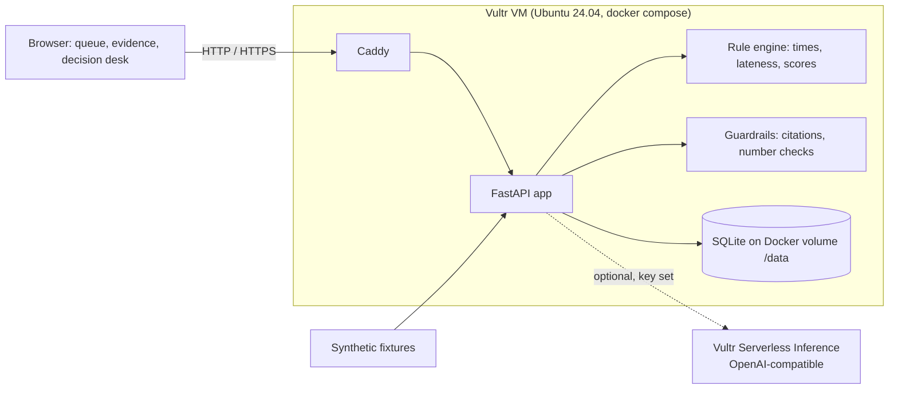

# GradeCase

**A case desk for academic grading exceptions.** *"정보는 있는데, 사건은 없다"* - the information exists, but the case doesn't.

GradeCase connects the scattered records behind a grading complaint (attempt log, deadline, late policy, rubric, gradebook, and the same message arriving by Inbox, email and submission comment) into **one case with evidence, rules and an approval trail**. AI explains and drafts; **humans decide**. Times, scores and deductions are computed by code, never by the model, and the system never changes a grade or sends a message.

Built for the Vultr: Agent Rush hackathon (lablab.ai x Vultr), Track 2 "Powering the Future of Work".

> **Live demo (HTTP only): http://45.77.185.101** - see [Deployment status](#deployment-status) for what is and is not running there.
>
> **Synthetic demo data only.** No real student records. No grades are changed and no messages are sent. Canvas is not connected.

## Tech stack

| Layer | Choice |
|---|---|
| Hosting | Vultr VM (Ubuntu 24.04), `docker compose`, Caddy |
| AI (optional) | Vultr Serverless Inference, OpenAI-compatible API; deterministic mock mode without a key |
| Backend | FastAPI (Python 3.12+), rule engine and guardrails in plain Python |
| Storage | SQLite on a Docker volume |
| Frontend | Plain JavaScript and CSS, no build step, no chart or animation library |
| Tests | pytest (provider stubs, no live calls), ruff, a Playwright browser smoke |

## Screenshots

Placeholders until real captures are added to `docs/screenshots/`.

| Dashboard | Evidence + AI card | Decision |
|---|---|---|
|  |  |  |

## More documentation

- [docs/PRODUCT_PLAN.md](docs/PRODUCT_PLAN.md) - product context (stub, see the note inside)
- [docs/REBUILD_SPEC.md](docs/REBUILD_SPEC.md) - the UI rebuild specification
- [docs/ARCHITECTURE.md](docs/ARCHITECTURE.md), [deploy/DEPLOY.md](deploy/DEPLOY.md)

## Problem

When a student writes "I submitted on time but it says late" or "I got 0", a TA or professor has to rebuild the story by hand: the same complaint arrives in the LMS inbox, by email and as a submission comment; the facts live in four places (attempt log, deadline, late policy, rubric and gradebook); and a late-policy exception can only be granted by the professor. Replies get duplicated, evidence is lost, and nobody can later say who decided what.

## Features

GradeCase turns scattered messages into **one case with one evidence bundle**, and keeps a human in every decision.

- **Unified queue and duplicate detection.** Messages from `canvas_inbox`, `email` and `submission_comment` become cases. Cases with the same student, course, assignment and issue are *proposed* as duplicates; a TA confirms any merge. The same student with a different assignment is never proposed.
- **Evidence timeline with stable source IDs** (`ATT-A1`, `RUB-B-row2`, `POL-LATE-v1`). "Not submitted", "unreadable", "empty file" and "alternate evidence" are separate states. A missing professor approval or unreadable file shows an "Insufficient evidence" warning.
- **Score-state reconciliation by rules.** Rubric total, entered score, late deduction, final score and graded-vs-posted are shown separately. Differences are computed, never auto-corrected.
- **Approval routing.** New, TA review, Awaiting professor, Awaiting student info, Closed. A student request alone never approves a waiver. Policy exceptions and score changes route to the professor. A missing policy or conflicting records puts the case on hold.
- **Grounded reply draft.** The draft separates *verified facts* (with evidence IDs) from *unverified* statements. A human edits and approves it, a decision log entry (who, role, action, time, note) is stored, and the screen says "Draft only - not sent".

- **Explicit AI analysis.** On the Decision screen a person clicks **Run analysis**; the app records the real stages it performed (load evidence, compute checks, call model, validate, prepare draft, await human), the model, latency and token counts. Nothing calls a model on page load. A valid analysis is reused until the evidence changes.
- **Intake you can use.** *New synthetic case* takes a validated, synthetic-only message plus structured records, or **a screenshot, PDF, Word file, text or CSV** that the model reads into editable fields before anything is created.
- **Board and Calendar.** A kanban *Board* (drag a card, or use its Move menu; every move is a real logged decision under the normal rules) and a *Calendar* of deadlines, case-open dates and decision dates.

**Code computes, AI drafts.** Times, lateness and scores come from `app/engine.py`. The optional AI only classifies, summarizes and drafts, and its output is checked by `app/guardrails.py` (citations must exist; numbers and times that conflict with the code are flagged "Needs verification" next to the code value; promises of a regrade are flagged).

## How it uses Vultr

- **Vultr VM**: the whole app (Caddy + FastAPI + SQLite on a Docker volume) runs on one Ubuntu 24.04 instance via `docker compose`. See [deploy/DEPLOY.md](deploy/DEPLOY.md).
- **Vultr Firewall (recommended, NOT yet configured)**: no Vultr Firewall group is set up on the current VM. We recommend allowing only ports 22, 80 and 443; the steps are in [deploy/DEPLOY.md](deploy/DEPLOY.md).
- **Vultr Serverless Inference (optional).** With `VULTR_INFERENCE_API_KEY` and `LLM_MODEL` set on the server, analysis and file intake call the OpenAI-compatible endpoint (`/chat/completions`). **Live inference has not been verified by the developer of this code**: the client is tested against HTTP stubs only. The operator reports a separate preflight call to `qwen3.8-flash-next` succeeded; the first real run in this app is still pending. Without a key the app runs in a deterministic mock mode and the UI says so. The rail shows "Live AI: last call succeeded" only after a real successful call is recorded.

## Architecture



Details and the data model: [docs/ARCHITECTURE.md](docs/ARCHITECTURE.md).

### Trust boundaries

| Component | Trusted to | Not trusted to |
|---|---|---|
| Rule engine (code) | compute times, deductions, score differences, routing | interpret ambiguous policy |
| AI (optional) | classify, summarize, draft wording | produce numbers, decide policy, promise outcomes |
| Guardrails | reject unknown citations, flag number/time conflicts and commitments | replace human review |
| Student/LMS text | be shown as quoted source text | be followed as instructions (kept in separate `source_text` fields, passed to the model as data) |
| Human TA / professor | decide and approve | (demo role switch is **not** access control) |
| GradeCase | record recommendations | write to Canvas or send messages (neither exists) |

## AI analysis, safety limits and what is (not) verified

Everything below is enforced on the server and covered by tests that use an HTTP stub in place of the provider.

- **Request shape** (from the operator's live findings for `qwen3.8-flash-next`): `max_completion_tokens` (default and hard ceiling 2048), `reasoning.max_tokens` (default 128, always below the completion cap), `response_format: {"type":"json_object"}`, `temperature` 0. A reply whose `finish_reason` is not `stop`, or that is empty, is discarded. Reasoning text is never read, stored or shown: only the answer, token counts and outcome metadata are kept.
- **Spending safety.** A **lifetime** cap on provider HTTP attempts (`AI_LIFETIME_MAX_CALLS`, default 50) is reserved in a database transaction *before* every attempt, including any retry, and is never refunded, even if the call fails or times out. Prompts are capped at 32,768 UTF-8 bytes (system + user, with per-message overhead) and refused *before* a reservation. Retries are off by default (`LLM_MAX_RETRIES=0`, ceiling 1). A per-client hourly limit (`AI_CLIENT_HOURLY_LIMIT`) returns 429 with `Retry-After`. Clients cannot choose the model, URL, token cap or budget.
- **The budget survives restarts and "Reset demo data".** The counters and the per-attempt log (time, case, provider, model, prompt bytes, outcome) are kept. Do not run `docker compose down -v`: it deletes the volume and with it the counters. The only reset is an operator command that refuses to run without an explicit flag (see [deploy/DEPLOY.md](deploy/DEPLOY.md)).
- **Worst-case arithmetic.** At the defaults: 50 attempts x (32,768 prompt bytes + 2,048 completion tokens). Using the operator-reported prices of $0.10 (input) and $0.20 (output) per 1M tokens, which we have not verified in the console, and counting one token per byte as a deliberate overestimate, that is about $0.16 + $0.02, well under $1. Image inputs are bounded by the 5 MiB upload cap rather than the prompt cap and cost depends on the provider's image tokenisation; the same 50-attempt cap applies.
- **Fail closed.** A live reply that is malformed, off-schema, cites an unknown record, states a number or time that conflicts with the rule engine, or promises an outcome is **rejected**. A clearly labelled rules-only template is shown instead and is never presented as AI output.
- **What validation does NOT prove.** It checks citations, numbers, times and promise wording against the records. It cannot prove every statement is true or complete, or that the reply is appropriate. A person must read the reply before approving, and the UI says so.

## Uploads: screenshots and documents (synthetic data only)

`POST /api/intake/upload` (also reachable as `/api/intake/vision`) accepts PNG, JPEG, WebP, **PDF**, **DOCX**, and plain text / CSV, up to 5 MiB. The type is decided from the file's bytes, not its name. Images go to the vision model. Documents are parsed on the server (pdfplumber, python-docx) in a short-lived child process with a time limit and memory limit, then their text, truncated to fit the prompt cap, goes to the text model as data. The model returns the same fields either way; a person reviews and edits them, then creates the case through the normal validated intake.

- Files are processed in memory: not written to disk, not logged, not stored. The response never contains the file or the raw model text.
- You must tick that the file is synthetic. Extracted emails, phone numbers, links and long numbers are removed, and a student id must be a pseudonymous `S-XXXX`; real names are dropped. This reduces risk but cannot detect every real name inside free text: do not upload real student material.
- Every attempt uses the same lifetime budget and per-client limit as text analysis.
- Limits: no OCR (a scanned PDF with no text layer is refused: upload it as an image); one case per upload (a CSV with many students yields only the first); only the first 20 PDF pages are read.
- PyMuPDF was not used because it is AGPL-licensed; pdfplumber is MIT.

**Pending live verification (operator):** a first real analysis run, a real screenshot extraction, a real PDF/DOCX extraction, and confirming that `/api/ai/status` then shows `last_success_at`.

## Interface and dashboard

Deliberate differences from the rebuild spec: there is no "~12 min saved per case" tile (nothing measures it, so the dashboard shows average model latency instead); the sidebar says "Connected" only after a real successful model call; the one-line pitch is not used verbatim because "catches errors humans miss" is not something we have measured.

The app opens on a **Dashboard** (`#/dashboard`): total cases, cases needing action, cases closed today and average model latency, a status bar chart, an AI performance card and a recent-activity feed. Every number is computed in the browser from existing endpoints plus two read-only ones: `GET /api/activity?limit=` (real analysis runs, decisions and new cases, newest first) and the `runs` block of `GET /api/ai/status`. Nothing is estimated; there is no "time saved" figure. In mock mode the AI card says so and never shows "Connected"; that label appears only after a real successful model call.

The evidence page shows the six persisted pipeline stages, the guardrail results (citation, time, number, commitment checks) and a **See the guardrails catch a bad reply** button. That button calls `POST /api/cases/{id}/guardrail-demo`, which runs a canned faulty reply written by us through the same guardrail code. It is labelled as not coming from a model, stores nothing and uses no budget.

`POST /api/intake` accepts an optional `issue` (`late_flag`, `score_gap`, `missing_submission`, `other`); when omitted the server classifies it as before.

The page loads Inter and JetBrains Mono from Google Fonts. That is the only third-party request the UI makes; if it is blocked the system fonts are used.

## Demo script (2-3 minutes, Case A)

1. **Queue (20s).** Open the app. Point at the banner. Case A (`CASE-A`, canvas inbox) and `CASE-A2` (email) both carry a *Duplicate candidate* badge; `CASE-D` (same student, HW2) does not. Click **Confirm merge** as TA: evidence combines into `CASE-A` and the merge is logged.
2. **Evidence View (45s).** Open `CASE-A`. Attempt 1 at 22:40 is 79 min early; attempt 2 at 00:10 is 11 min late; the 2-point late deduction was applied because the newest attempt is graded. Score table shows rubric total 9, deduction 2, final 7, entered 7, posted 7 with no differences. Warning: "Insufficient evidence: no professor approval on file". Review item: "Confirm whether ATT-A1 counts", routed to the professor.
3. **Decision Desk as TA (45s).** Click **Run analysis** (in mock mode this is free and says no model was called) and watch the real stages complete. The draft's verified facts cite `ATT-A1`, `ATT-A2`, `SCORE-A`; the policy question is listed as unverified; the text does not say what the outcome will be. **Approve** and **Reject** are disabled (professor-only). Click **Escalate to professor** with a note: status becomes Awaiting professor, logged.
4. **Professor (45s).** Flip the role switch to Professor. Select counted attempt `ATT-A1`, add a note, **Approve**. Status Closed; `APR-A-1` appears as approval evidence; **Record score recommendation** becomes enabled and records "7 -> 9, recommendation only, not applied in Canvas". Show the decision log.
5. **Wrap (15s).** Open `CASE-C`: policy `POL-LATE-v2` is missing and the emailed file cannot be found, so Approve is blocked and the draft promises nothing.

## Run locally (mock AI, no credentials)

Needs Python 3.12+.

```bash
python -m venv .venv && source .venv/bin/activate && pip install -r requirements-dev.txt
export DB_PATH=./gradecase.db
uvicorn app.main:create_app --factory --reload
```

Open http://localhost:8000. Checks: `ruff check . && pytest -q`. "Reset demo data" in the footer restores the cases (it does not touch the AI budget). For live AI set `VULTR_INFERENCE_API_KEY`, discover a model with `python -m app.tools models`, and set `LLM_MODEL`; every variable is documented in `.env.example`. A browser walkthrough (mock mode only) is in `scripts/ui_smoke.js`.

## Deploy to Vultr

Full steps in [deploy/DEPLOY.md](deploy/DEPLOY.md): create a firewall group (22/80/443), create an Ubuntu 24.04 instance with [deploy/cloud-init.yaml](deploy/cloud-init.yaml) as user-data, check `http://<SERVER_IP>/health`. Data persists in the `gradecase_data` Docker volume. cloud-init clones branch `claude/ecstatic-newton-ck2lvo`; switch `BRANCH` to `main` after merge.

## Deployment status

Reported by the team after deploying commit `d6ff215` (the QA below was done on that commit). **The code on this branch has moved well past it (live-AI integration, uploads, Board, Calendar) and none of that has been deployed or tested on the VM.**

- Live at **http://45.77.185.101** on a Vultr VM, via `docker compose` (app + Caddy).
- The Docker app container reports healthy, and Caddy serves the app over plain HTTP.
- A container restart preserved recorded decisions (SQLite on the `gradecase_data` volume).
- **HTTP only for now.** No domain or HTTPS is configured, so do not enter anything sensitive; the data is synthetic anyway.
- **At that deployment, real inference was NOT connected** (no key, mock mode).
- The VM is paid for with an ordinary signup promotion. We are not claiming hackathon credits.

## Demo URL / video / slides

- Demo URL: http://45.77.185.101 (HTTP only, mock AI)
- Demo video: TODO
- Slides: TODO

## Limitations

- **Synthetic data only.** Do not load real student records. Using GradeCase with real data requires FERPA and institutional review (data handling, retention, access control, vendor review) that has **not** been done.
- **Demo roles are not access control.** The TA / Professor switch is a UI label that the API trusts; there is no login.
- **No Canvas integration.** Messages and course data come from fixtures; nothing is read from or written to Canvas. Canvas would stay the system of record in a real deployment.
- **No sending.** Replies are drafts. No email or LMS message is sent.
- The demo cases A to D use built-in records. A new case carries only what is entered at intake (or read from an upload); there is no Canvas or email connector.
- Board moves are real decisions: a drop on *Closed* still needs a reviewed reply, and cases cannot move back to *New*. The calendar's "overdue" marker is this demo's own 7-day threshold, not a policy.
- Late policy rules handled: flat percentage within a window and "newest attempt graded". Other policies are not modelled; unknown policies put the case on hold.
- Single worker and SQLite: fine for a demo, not for production.

## Team

- TODO: Name 1 - role
- TODO: Name 2 - role

## License

MIT - see [LICENSE](LICENSE).
