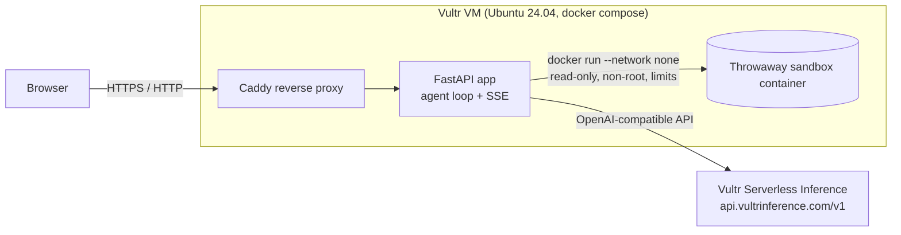

# TODO: Product Name

> TODO: one-line tagline. (Also set `PRODUCT_NAME` / `PRODUCT_TAGLINE` in `.env` for the UI.)

Starter for our entry in the **Vultr: Agent Rush** hackathon (lablab.ai x Vultr).
The topic is not chosen yet; everything marked `TODO` must be filled in once it is.

## Overview (TODO)

TODO: 3-4 sentences. Who has the problem, what the agent does, why it matters (Business Value).

## Track (TODO)

TODO: pick one and delete the other.

- **Track 1 - Blast Radius Zero**: agent that writes/runs code or drives a browser inside an isolated sandbox. Uses `app/sandbox/` and Vultr Serverless Inference. The demo must show one *containment moment* (a red `blocked` event).
- **Track 2 - Powering the Future of Work**: multi-step enterprise workflow on a Vultr VM with a human approval step. Uses the approval gate (`requires_approval` tools). Serverless Inference is optional.

## Vultr architecture



More detail in [docs/ARCHITECTURE.md](docs/ARCHITECTURE.md).

## How we use Vultr

- **Vultr VM (compute instance)** hosts the whole stack with `docker compose` (Caddy + FastAPI). See [deploy/DEPLOY.md](deploy/DEPLOY.md). *TODO: verify the exact product name in the console.*
- **Vultr Firewall** group allows only ports 22, 80 and 443 to the VM.
- **Vultr Serverless Inference** is the LLM behind planning and verification (`app/llm.py`, OpenAI-compatible, base URL `https://api.vultrinference.com/v1`). `GET /api/models` lists the models actually available to our key. *TODO: record which model we chose and why.*
- TODO: anything else we end up using (object storage, managed DB, ...).

## Run locally (mock mode, no credentials)

Needs Python 3.12+.

```bash
python -m venv .venv && source .venv/bin/activate && pip install -r requirements-dev.txt
uvicorn app.main:app --reload
# open http://localhost:8000 and click one of the "Try:" chips
```

Run the checks: `ruff check . && pytest -q`.

With no `VULTR_INFERENCE_API_KEY` the LLM is a deterministic mock and the sandbox is a mock, so the whole flow (timeline, red blocked event, approve/reject) works offline. To use real inference: `cp .env.example .env`, set the key, run `curl localhost:8000/api/models`, put a real model id in `LLM_MODEL`, then restart (load the file with e.g. `set -a; source .env; set +a`).

## Deploy to Vultr

Step by step in [deploy/DEPLOY.md](deploy/DEPLOY.md). Short version: create an Ubuntu 24.04 instance with `deploy/cloud-init.yaml` as user-data, attach a firewall group (22/80/443), SSH in, put the key in `/opt/agent-rush/.env`, run `docker compose up -d --build`.

## Demo URL / Demo video / Slides

- Demo URL: TODO
- Demo video: TODO
- Slides: TODO

## Team

- TODO: Name 1 - role - links
- TODO: Name 2 - role - links

## License

MIT - see [LICENSE](LICENSE).
